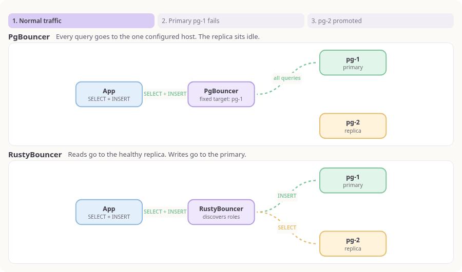

# RustyBouncer

**A PgBouncer alternative that follows your Postgres primary.**

When your primary fails over, PgBouncer keeps sending queries to the old host
until you change DNS or its config. RustyBouncer finds the new primary on its
own, so your app keeps one endpoint and fewer errors.

**[Quick start](#getting-started-with-docker-compose)** · [How routing works](docs/routing.md)



- **Rides through failover.** Writes not yet sent wait for the new primary.
  Idle clients keep their connection.
- **Uses your replicas.** In unshared mode, eligible reads go to healthy
  replicas. Shared session and transaction pools stay on the primary.
- **Secures shared pools.** TLS, SCRAM through `auth_query`, and certificate
  rotation without a restart.
- **Tested on real clusters.** CloudNativePG suites in kind cover routing,
  failover, TLS and authentication.

Works with any standard PostgreSQL deployment. CloudNativePG is supported, not
required.

## Getting started with Docker Compose

Requires Docker Engine with Compose v2. No local PostgreSQL client is needed. The [Compose example](deploy/compose/compose.yaml)
starts PostgreSQL and RustyBouncer on an isolated network.

```sh
git clone https://github.com/wesbragagt/rustybouncer.git
cd rustybouncer
docker compose -f deploy/compose/compose.yaml up -d
docker compose -f deploy/compose/compose.yaml exec -T postgres \
  pg_isready -h rustybouncer -p 6432 -U postgres -d postgres
```

Repeat the readiness command until it reports `accepting connections`.
All queries below connect **through RustyBouncer**, using the client bundled in
the PostgreSQL container.

### Try queries interactively

Humans or agents with an interactive terminal can open `psql`:

```sh
docker compose -f deploy/compose/compose.yaml exec postgres \
  psql -h rustybouncer -p 6432 -U postgres -d postgres
```

Try `SELECT 42;` or `SELECT pg_is_in_recovery();` (expect `f`). Enter `\q` to exit.

### Run a repeatable query check

For scripts and agents, this command needs no terminal and exits nonzero on SQL
errors. Temporary data disappears when the connection closes.

```sh
docker compose -f deploy/compose/compose.yaml exec -T postgres \
  psql -h rustybouncer -p 6432 -U postgres -d postgres \
  -X -v ON_ERROR_STOP=1 <<'SQL'
SELECT 42 AS answer;
CREATE TEMP TABLE demo (amount integer);
INSERT INTO demo VALUES (10), (20);
SELECT sum(amount) AS total FROM demo;
BEGIN;
UPDATE demo SET amount = 0;
ROLLBACK;
SELECT sum(amount) AS total_after_rollback FROM demo;
SQL
```

Expect `answer = 42`, `total = 30`, and `total_after_rollback = 30`.
For a machine-readable assertion:

```sh
answer=$(docker compose -f deploy/compose/compose.yaml exec -T postgres \
  psql -h rustybouncer -p 6432 -U postgres -d postgres \
  -X -v ON_ERROR_STOP=1 -Atc 'SELECT 42;') && test "$answer" = 42
```

This demo uses trust authentication and one primary; it demonstrates connectivity
and transactions. For secured deployment and replicas, follow the
[CloudNativePG guide](deploy/cnpg/README.md).

Stop the demo while keeping its database volume:

```sh
docker compose -f deploy/compose/compose.yaml down
```

## Documentation and validation

- [Routing and failover behavior](docs/routing.md)
- [Configuration and native setup](docs/getting-started.md)
- [Deployment options](docs/deployments.md)
- [Prometheus metrics](docs/metrics.md) and [Grafana dashboards](docs/grafana.md)
- [CloudNativePG tests in kind](tests/kubernetes/README.md), including TLS, certificate rotation, and authentication
- [Benchmark results and limitations](docs/benchmarks/performance-final.md)
- [Publication audit and historical evidence](PUBLICATION.md)

Run local verification with `nix flake check --no-update-lock-file`.
Broader production and release acceptance remains incomplete.

## License and feedback

Licensed under [Apache 2.0](LICENSE). Report bugs and request features through
[GitHub issues](https://github.com/wesbragagt/rustybouncer/issues).
[Pull requests are welcome](CONTRIBUTING.md).
